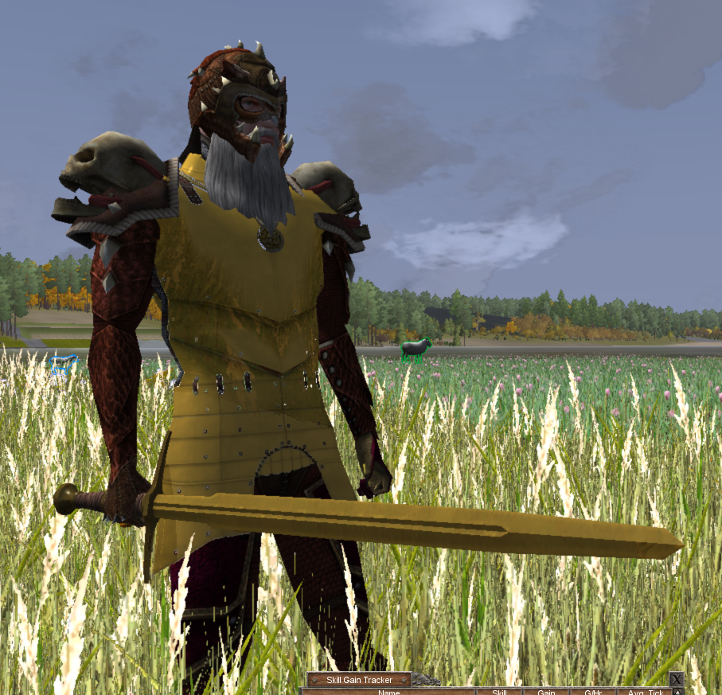

# Material Colors



A client mod for Wurm Unlimited that brings out metal colours on equipment
and adds environment reflections to Gold, Silver, Seryll and Adamantine.

Version **0.3.23** includes Chamomilo Updater **1.2.7** and Chamomilo UI **0.4.10**.

## Features

- Restores each metal's stock colour on worn plate and chain armour.
- Makes metal colours clearer on weapons and tools while preserving the stock
  hue. Iron and wooden materials keep their original appearance.
- Adds reflections to Gold, Silver, Seryll and Adamantine armour, helmets,
  weapons, tools, shields and other items with a metal material mask.
- Keeps Seryll's red/copper hue and Adamantine's blue hue in reflected light.
- Uses softer reflections on plate and chain armour and sharper reflections
  on separate masked items. The default reflection strength is 80%.
- Keeps equipped metal and paperdolls visible without recolouring wooden
  handles or filling transparent texture cutouts.

Reflections require Wurm's modern deferred renderer. The legacy renderer
retains the colour improvements. Reflection detail varies with the visible
scene, viewing angle and lighting because it uses screen-space reflections
with a sky/ground fallback.

The mod uses the original models, textures and metal masks. It supplies a
full-metal mask for the stock standalone plate/chain armour models and their
piles. Other models without a material mask retain their original rendering.

## Installation

1. Install Ago's Wurm Unlimited Client Mod Launcher.
2. Download the ZIP from the [latest release](https://github.com/chamomilo/wurm-material-colors/releases/latest).
3. Close the client and extract the ZIP into WurmLauncher, merging the supplied
   mods directory with the existing one.
4. When upgrading, remove the previous armor-material-colors JAR and its
   matching resources JAR from mods/armor-material-colors. Keep the two new
   version-matched JARs and the supplied properties file.
5. Restart the client and re-equip or drop the affected equipment to refresh it.

The ZIP includes README.txt and the licence. The project screenshot and
Markdown documentation are kept in the GitHub repository.

## Configuration

Edit `mods/armor-material-colors.properties` while the client is closed.
Changes take effect after restarting the client.

- `reflectionStrength`: overall reflection amount, from 0 to 1; default 0.80.
- `reflectionTint`: how much the metal hue colours reflected light; default 0.72.
- `sunGlintStrength`, `localGlintStrength`, `glintSharpness`: direct-light highlights.
- `environmentBrightness`, `reflectionContrast`, `skyBrightness`,
  `groundBrightness`, `caveBrightness`: reflected environment brightness.
- `ssrDetail`, `ssrRayDistance`, `ssrThickness`: screen-space reflection detail
  and reach.

Keep `classpath` and `resourcePack` matched to the installed release filenames.
Normal operation is silent; loading failures and invalid settings are logged.

## Updates

The embedded Chamomilo updater shares one update check and one Mod updates
window with compatible Chamomilo mods. It opens the release page; installation
is manual. Its language selector applies the chosen language to capable
installed mods. English, Brazilian Portuguese, German and Russian are supported
by the updater interface.

## Building

Use JDK 8, the Gradle wrapper and the Wurm client development libraries
client-patched.jar, common.jar, javassist.jar and modlauncher.jar. Set
WURM_CLIENT_LIBS or pass `-PwurmClientLibDir=/path/to/libs`.

The canonical shared updater is built and verified during release builds.
Set CHAMOMILO_UPDATER_REFERENCE or pass
`-PchamomiloUpdaterReference=/path/to/updater` when it is outside the default
development location. The updater includes its pinned Chamomilo UI dependency.
If JavaFX is not included in the JDK, pass `-PwurmJavaFxJar=/path/to/jfxrt.jar`.

```text
gradlew clean build verifyMaterialOpacityGpu dist
```

The optional GPU check needs Wurm's LWJGL native libraries. Set
`-PwurmNativeLibDir=/path/to/nativelibs` for that check. It uses a hidden offscreen
context and does not launch or modify the game. It checks all four reflective
metals in the stock forward shaders and the modern material-mask shader,
including instanced drawing, handles and transparent cutouts.

The installable ZIP is written to build/distributions. Its contents and the
exact embedded updater module are checked before the distribution task completes.
README.txt is generated from this README during the build, without the image
or Markdown formatting.

## Licence

See [LICENSE](LICENSE) for the GNU General Public License, version 3.
