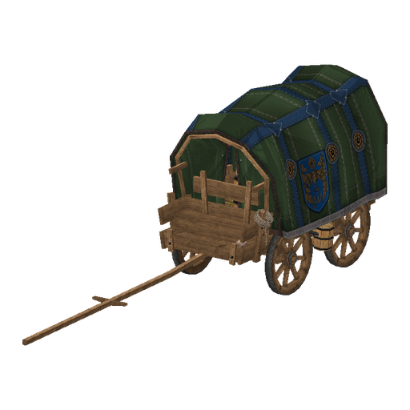
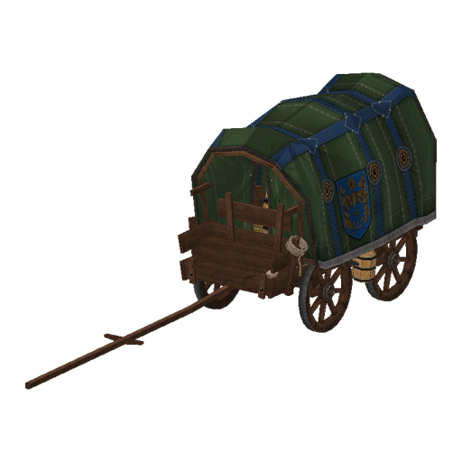
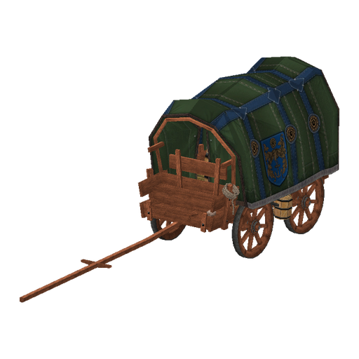
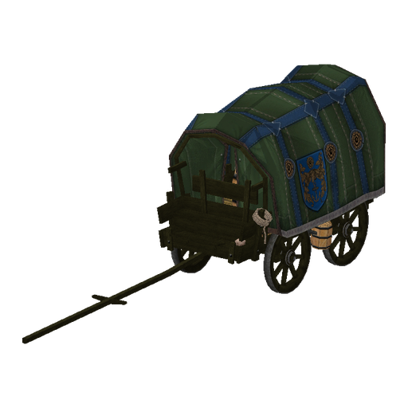
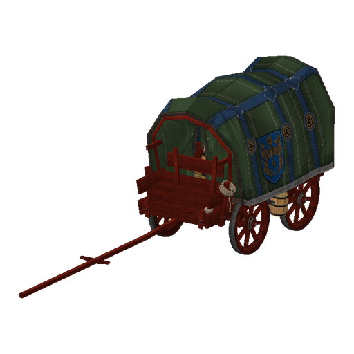
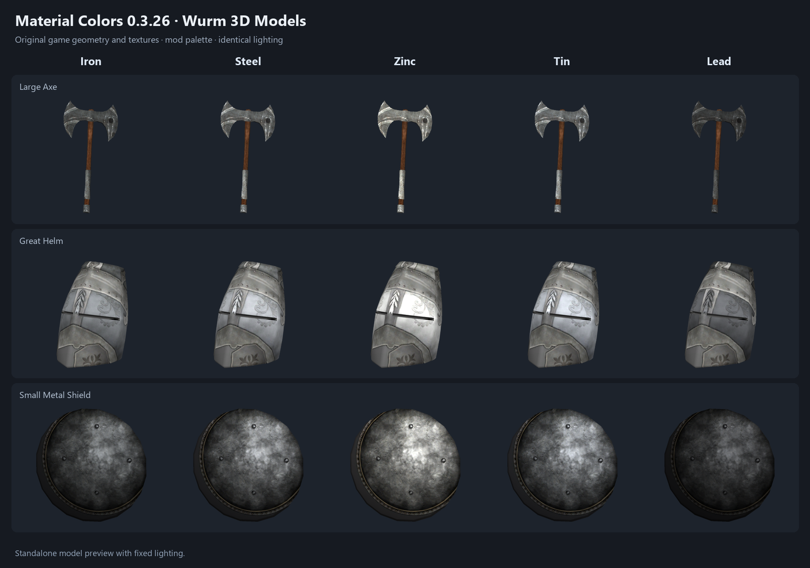
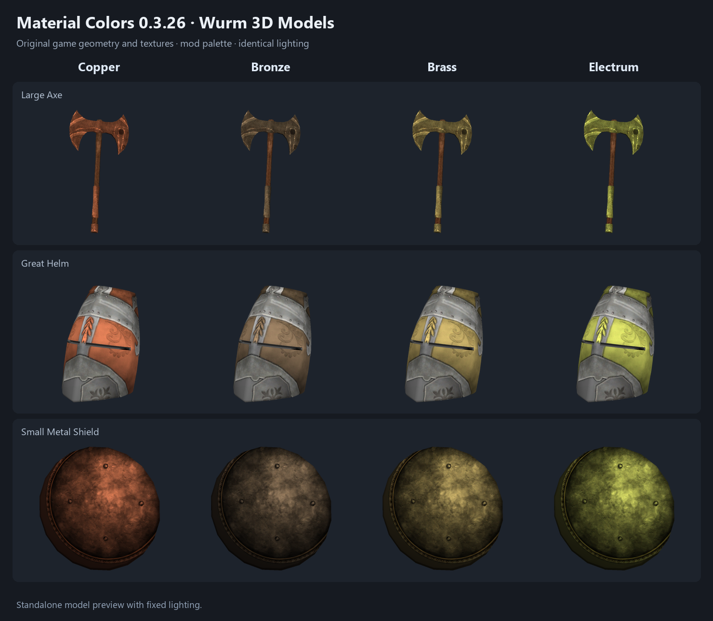
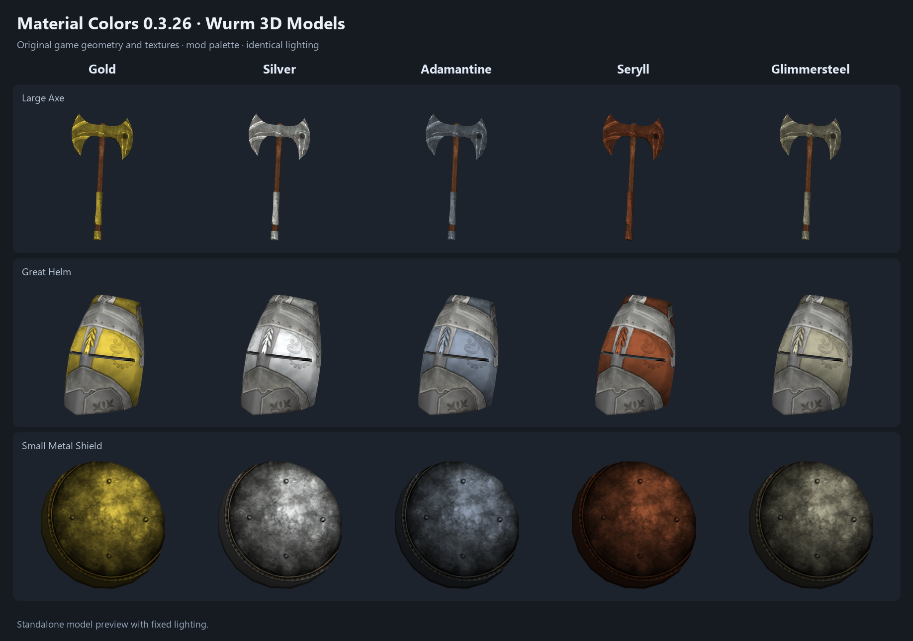
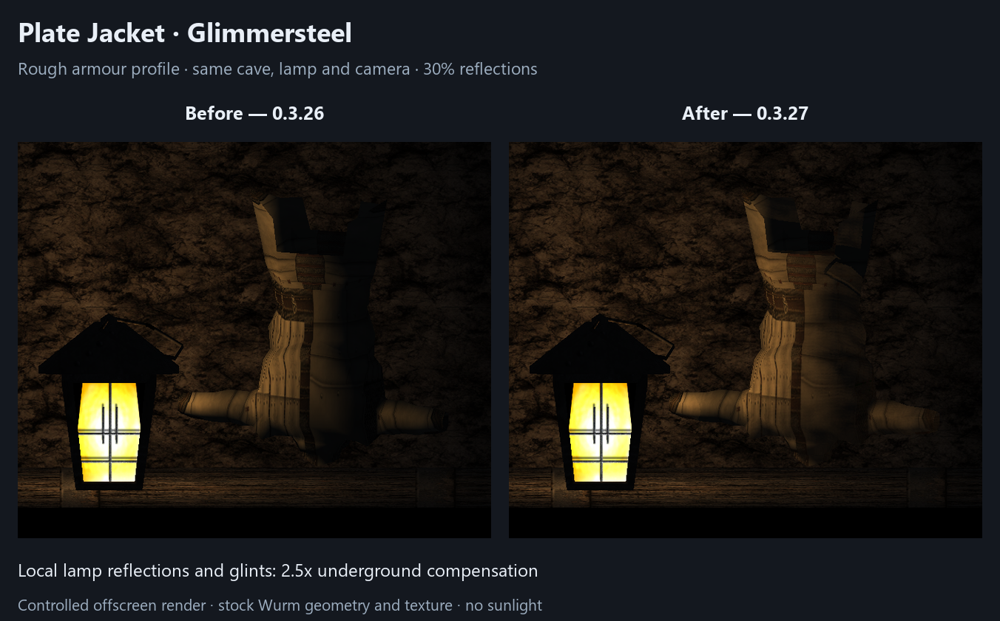

# Material Colors

Wood and metal finishes for **Wurm Unlimited**, based on the material each item is made from.

**[Download 0.5.1](https://github.com/chamomilo/wurm-material-colors/releases/tag/v0.5.1)** · Requires Ago's Wurm Unlimited Client Mod Launcher.


## Wood species

All **26 stock wood materials**, including shrub woods, have their own colour.
The mod restores missing material masks on furniture, containers, racks,
wooden parts, tools, piles and vehicles, including the PMK wagon frame.
Fabric, metal components and stored equipment retain their separate surfaces.
Existing stock and custom masks take precedence.

| Birch | Oak | Walnut |
| --- | --- | --- |
|  |  |  |

| Cherry | Thorn | Lingonberry |
| --- | --- | --- |
|  |  |  |

These previews use original game geometry and textures under the same studio
lighting. They are colour references rather than screenshots of gameplay.
See the [complete palette](docs/wood-references/wood-sampler-all.png), or download
the [interactive sampler](https://raw.githubusercontent.com/chamomilo/wurm-material-colors/main/docs/wood-references/wood-sampler.html)
and open it in a browser for five model previews per species.

The [complete model list](docs/wood-audit/added-models.md) covers 297 paths with
missing masks in an audited mesh or pack variant. Stock house walls, floors,
roofs and stairs retain a structural material category, so their original
construction species cannot be recovered by a client mod. Unknown replacement
packs may need their own mask review.

## Metal finishes

One palette covers all **14 metals** on supported held and ground equipment,
shields, helmets and worn plate/chain armour. Neutral armour textures prevent
the material colour from being applied twice. Wooden handles, leather,
painted details and transparent cutouts keep their appearance.







**Gold, Silver, Adamantine, Seryll and Glimmersteel** receive environment
reflections, with a softer finish on armour. Reflections require the modern
deferred renderer; material colours also work with the legacy renderer.
The default reflection strength is **30%**.

Lamp and torch reflections receive **2.5x** compensation underground.
Screen reflections depend on the visible scene, lighting and viewing angle.



The metal gallery and cave comparison use controlled renders of stock assets.

## Installation

1. Download `armor-material-colors-0.5.1.zip` from the [release page](https://github.com/chamomilo/wurm-material-colors/releases/tag/v0.5.1).
2. Close the game.
3. When upgrading, remove the old `armor-material-colors-*.jar` and `armor-material-colors-resources-*.jar` from `mods/armor-material-colors`.
4. Extract the ZIP into **WurmLauncher**, merging the supplied `mods` directory.
5. Restart the client. Re-equip or drop affected equipment if its model needs refreshing.

The ZIP contains exactly four files:

```text
mods/armor-material-colors.properties
mods/armor-material-colors/armor-material-colors-0.5.1.jar
mods/armor-material-colors/armor-material-colors-resources-0.5.1.jar
mods/armor-material-colors/README.txt
```

The gallery and source stay in this repository. Licence notices are embedded in the mod JAR.

## Settings and updates

Open **Main menu > Mod updates**, find **Material Colors**, and press **Settings**.
The bundled **Chamomilo Updater 1.5.0** provides the shared Mods Registry and
settings editor, using **Chamomilo UI 0.4.11**. All 18 product settings have hover
help. Valid edits are saved automatically; reflection tuning applies immediately.
Changing the resource pack requires a restart and shows a restart notice.

| Setting | Default | Effect |
| --- | --- | --- |
| Reflection strength | 0.30 | Strength of environment reflections. |
| Reflection tint | 0.72 | Amount of metal hue in reflected light. |
| Cave local reflection boost | 2.50 | Underground local-light compensation; 0 disables the extra contribution. |
| Sun glint strength | 0.28 | Direct sunlight highlights. |
| Local glint strength | 0.32 | Lamp and torch highlights. |
| Glint sharpness | 0.45 | Concentration of highlights. |

See [all settings](docs/SETTINGS.md) for advanced controls and persistence.
The shared language selector supports English, Brazilian Portuguese, German
and Russian. Compatible Chamomilo mods share one registry and select the newest
compatible embedded updater. It opens release pages; installation is manual.

## Build from source

Use **JDK 8**, the Gradle wrapper and the client libraries `client-patched.jar`,
`common.jar`, `javassist.jar` and `modlauncher.jar`. Set `WURM_CLIENT_LIBS` or
pass `-PwurmClientLibDir=/path/to/libs`. The shared updater reference is configured
through `CHAMOMILO_UPDATER_REFERENCE` or `-PchamomiloUpdaterReference=/path/to/updater`.
Supply `-PwurmJavaFxJar=/path/to/jfxrt.jar` when its native UI probe needs JavaFX.

```text
gradlew clean build dist
```

The build runs the product and shared-updater checks, compares the embedded
module byte for byte, and verifies the four-file ZIP in `build/distributions`.
`verifyMaterialOpacityGpu` additionally checks shaders in a hidden offscreen
context. The release's [wood coverage notes](docs/WOOD-AUDIT.md) describe its
asset and colour verification.

## Licence

[GNU General Public License v3](LICENSE). Source is available under the matching release tag.
